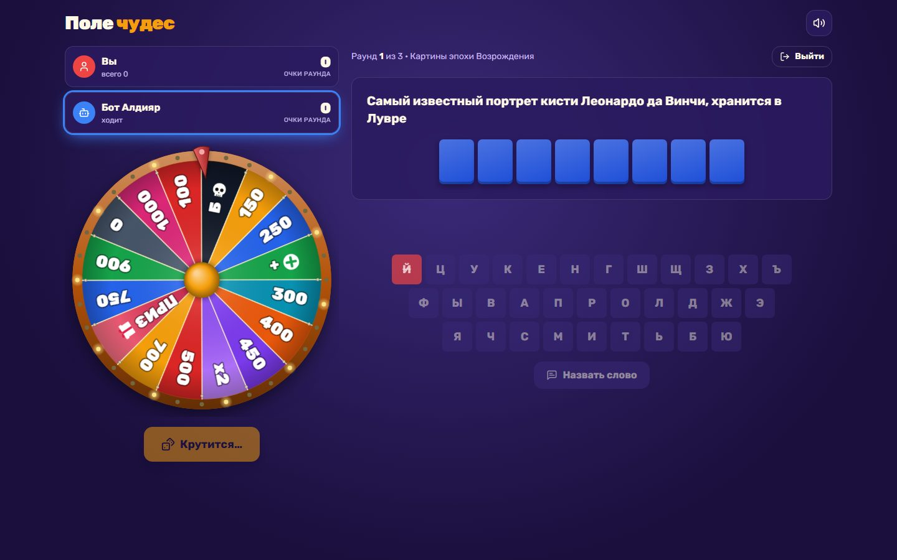
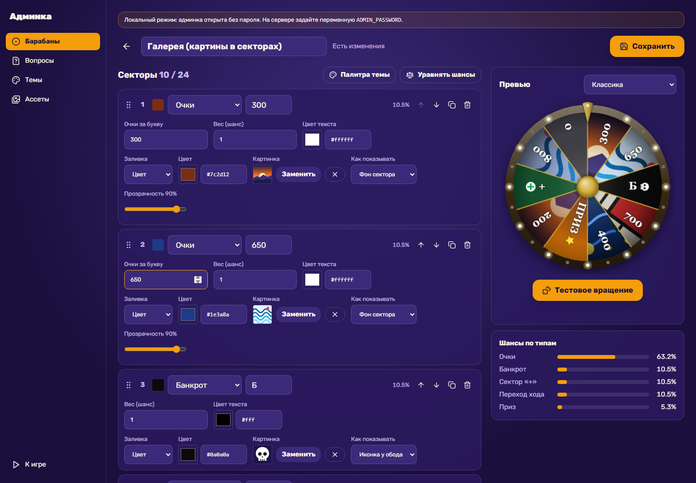
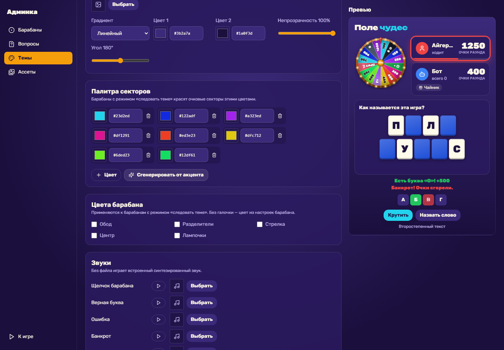

# Поле чудес

Веб-игра в стиле «Поле чудес»: барабан на Canvas, табло с переворачивающимися буквами, бот, локальный мультиплеер, режим ведущего, темы оформления и админ-панель.

**Играть:** https://pole-chudes-production-42f4.up.railway.app



<p>
  
  
</p>

**Стек:** React 18 · TypeScript · Vite · Tailwind CSS v4 · Zustand · Canvas API · Web Audio · Express · SQLite (better-sqlite3) · Vitest · Railway

Что внутри:
- **Барабан на Canvas** — 6–24 сектора, картинки в секторах, физика замедления, щелчки штырьков, пружинящая стрелка; исход выбирается до анимации (может задавать сервер)
- **Логика игры** — чистая функция `(state, action) → state`, покрыта тестами; бот трёх уровней
- **Админка** — конструктор барабана с живым превью, вопросы и категории, загрузка медиа, редактор тем с проверкой контраста WCAG
- **Сервер** — валидация всех входящих данных, защита паролем, SQLite на постоянном томе

## Запуск

```bash
npm install
npm run dev      # API (localhost:3001) + сайт (localhost:5173)
npm test         # тесты правил игры и серверной валидации
npm run build && npm start   # продакшен: один процесс на $PORT
```

- `/` — игра, `/admin` — админка, `/wheel` — песочница барабана.
- Локально админка открыта без пароля. Данные лежат в `./data` (SQLite + загрузки).

## Темы оформления

В админке → «Темы»: 12 цветов интерфейса с проверкой контраста (WCAG), шрифты (основной, заголовки, подписи барабана), фоновая картинка с градиентом поверх, палитра секторов, цвета барабана, свои звуки. Живое превью показывает настоящие компоненты игры. Темы можно дублировать, скачивать и загружать как JSON.

Сама админка всегда во встроенном оформлении, чтобы неудачная тема не сделала её нечитаемой.

## Переменные окружения

| Переменная | Зачем |
|---|---|
| `ADMIN_PASSWORD` | Пароль админки. **Обязателен в продакшене** — без него редактирование отключено. |
| `DATA_DIR` | Каталог для `pole.db` и `uploads/`. По умолчанию `./data`. |
| `PORT` | Порт сервера (Railway задаёт сам). |

## Деплой на Railway

1. New Project → Deploy from GitHub repo → `pole-chudes`. Сборка и запуск описаны в `railway.json`.
2. **Variables**: `ADMIN_PASSWORD=<пароль>`, `DATA_DIR=/data`.
3. **Volume**: подключить к сервису с путём монтирования `/data` — иначе база и загруженные картинки сбрасываются при каждом деплое.

При первом запуске база наполняется встроенными барабанами, темами и демо-вопросами.

## API

| Метод | Путь | Доступ |
|---|---|---|
| GET | `/api/bootstrap` — барабаны, темы, категории, вопросы одним запросом | все |
| GET/POST/PUT/DELETE | `/api/wheels`, `/api/themes`, `/api/categories`, `/api/questions` | чтение — все, запись — админ |
| GET/POST/DELETE | `/api/assets` (загрузка — `multipart/form-data`, поле `file`) | админ |
| POST | `/api/admin/login` `{ password }` → `{ token }` | все |

Запись требует заголовок `Authorization: Bearer <token>`. Сервер проверяет все входящие данные (`server/validate.ts`): типы, диапазоны, адреса медиа, CSS-значения.

## Структура

- `src/types/game.ts` — все типы (барабан, секторы, вопросы, темы, игроки, состояние партии)
- `src/utils/gameLogic.ts` — чистая логика партии `(state, action) → state`, покрыта тестами
- `src/utils/wheelMath.ts` — углы, взвешенный выбор сектора, кривая замедления
- `src/components/game/` — WheelCanvas, WordBoard, Keyboard, PlayerCard, GameSetup, GameScreen
- `src/components/admin/` — WheelEditor, SectionRow, QuestionManager, AssetLibrary, AssetGallery, ThemeList, ThemeEditor, ThemePreview
- `src/utils/theme.ts`, `src/utils/fonts.ts` — движок тем: CSS-переменные, градиенты фона, каталог Google Fonts с кириллицей
- `src/store/` — `dataStore` (контент с сервера), `gameStore` (партия)
- `server/` — Express + SQLite (`better-sqlite3`), загрузка медиа, авторизация

## Дорожная карта

1. ✅ Типы и схема БД
2. ✅ Движок барабана
3. ✅ Табло и логика игры
4. ✅ Админ-панель + API + SQLite + загрузка медиа
5. ✅ Редактор тем
